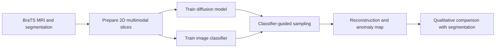
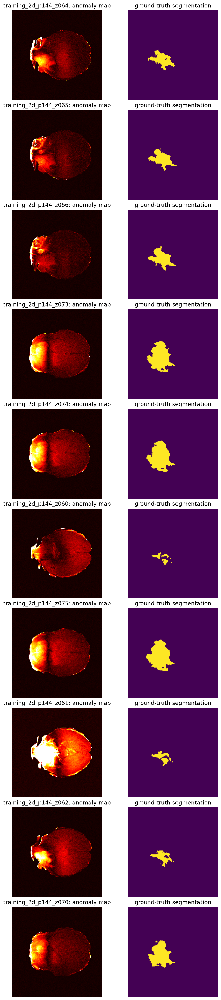

# Diffusion-based Brain MRI Anomaly Detection

This repository contains a SURF research implementation of classifier-guided diffusion for brain MRI anomaly detection. It adapts the diffusion model, classifier training and guided sampling workflow for 2D BraTS data.

## Workflow

## Example HPC output

*Selected 2D slices from one BraTS case. Left: anomaly maps from guided sampling. Right: ground-truth segmentation. These are training-data examples, not an independent test set; the figure is qualitative and does not establish generalisation or segmentation accuracy.*

Bright residuals can occur outside the annotated lesion, so visual agreement should be assessed alongside false positives. A proper quantitative evaluation requires a patient-level independent test split and a clearly specified metric and threshold protocol.

## Repository structure

- `guided_diffusion/`: diffusion model and BraTS data loader.
- `scripts/`: training, sampling, data preparation and visualisation.
- `train_diffusion.slurm`, `train_classifier.slurm`: example training jobs.
- `run_sampling.slurm`: example guided sampling job.
- `figures/`: example visualisation from the SURF HPC workflow.

## Reproducibility

Medical imaging datasets and trained checkpoints are not included. The Slurm scripts contain environment- and cluster-specific paths and need adjustment before use. Sampling reads the data directory and diffusion/classifier checkpoints configured for the run. This repository's training-data sampling example should not be confused with the separate SURF cDDPM-SparK benchmark.

The implementation builds on the diffusion-based medical anomaly detection work of Wolleb and colleagues; consult the original paper and implementation when comparing methods or results.
